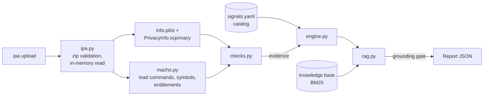

# App-roved

Static App Store compliance checker for iOS builds. Upload an `.ipa`, get back a report of what is likely to block or slow down review — with every finding labelled by **how we know it is a rule**.

```
 ✗ PRIV-001 [OFFICIAL/heuristic] Required-reason API used without a privacy manifest
   evidence: {'categories': {'NSPrivacyAccessedAPICategoryFileTimestamp': ['_stat'], ...}}
   source: https://developer.apple.com/documentation/bundleresources/describing-use-of-required-reason-api

 · REVIEW-002 [NOT_PUBLICLY_VERIFIABLE/heuristic] Remote feature-flag SDK linked
   evidence: {'libraries': ['FirebaseRemoteConfig']}
```

## Why the labels exist

"Why did Apple reject my app" advice is a mix of documented rules, folklore and guesses, and an LLM asked to audit a build will happily blend all three and invent a fourth. App-roved separates them:

| Label | Meaning | Can block? |
|---|---|---|
| `OFFICIAL` | Stated in a document Apple publishes. The signal must cite a `developer.apple.com` URL. | Yes |
| `COMMUNITY_HEURISTIC` | Consistently reported by developers (upload errors, forum threads) but not written down by Apple. | Yes |
| `NOT_PUBLICLY_VERIFIABLE` | A claim about reviewer behaviour nobody outside Apple can confirm. | Never — info only |

Each signal also records whether detection is `exact` (the bytes prove it) or `heuristic` (a linked symbol suggests it).

These are not conventions, they are enforced:

- **Findings come only from the catalog.** [`signals.yaml`](approved/data/signals.yaml) is the complete list of what can be reported. A check is registered against one catalog id and yields evidence, never prose. A test asserts checks and catalog are in 1:1 correspondence.
- **The catalog validates itself.** Loading fails if an `OFFICIAL` signal lacks an Apple URL, if a non-official signal carries a source, or if an unverifiable signal is anything above `info`.
- **The LLM explains; it does not decide.** The RAG layer receives a finding plus retrieved passages and writes 2–4 sentences. If the answer has no citation, or cites a passage that was not retrieved, it is discarded and a deterministic template is used instead.


## Hosted site

`index.py` serves the hosted version at [app-roved.vercel.app](https://app-roved.vercel.app): a landing page,
the free scan and a form for paid reviews (`web/`). Hosting limits uploads to about 4.5 MB, so the page trims
each .ipa in the browser first (`web/static/slim.js`): it keeps Info.plist, privacy manifests and each binary's
header, load commands, symbol strings and code signature, and drops compiled code and assets. A 48 MB test build
becomes about 2.5 KB and produces an identical report (`tests/test_slim.py`).

The site is configured with environment variables: `CONTACT_EMAIL`, `ORDER_WEBHOOK_URL` (a Discord or Slack
webhook that receives each order), `PAY_URL_REVIEW`, `PAY_URL_RESCUE`, `PRICE_REVIEW`, `PRICE_RESCUE` and
`LAUNCH_NOTE`. See `web/app.py`.

## Architecture



| Module | Responsibility |
|---|---|
| `ipa.py` | Treats the upload as hostile: rejects path traversal, oversized members and zip bombs; reads members in memory, never extracts to disk. |
| `macho.py` | Dependency-free Mach-O parser (thin and fat): PIE flag, linked/weak dylibs, rpaths, `LC_BUILD_VERSION`, encryption info, symbol string table, and entitlements from the code-signature SuperBlob. Bounds-checked against truncated or malicious binaries. |
| `checks.py` | 19 deterministic checks across Info.plist, privacy manifest, binary and signing. |
| `rag.py` | BM25 retrieval over a small bundled knowledge base, citation-validated explanations. |
| `api.py` / `cli.py` | FastAPI service and a CLI whose exit code can gate CI. |

## Quick start

```bash
pip install -e ".[dev]"
pytest                                   # 47 tests, no network, no API key

approved signals                         # print the catalog
approved scan MyApp.ipa                  # exit code 1 if there are blockers
approved scan MyApp.ipa --json

uvicorn approved.api:app --reload        # then open http://localhost:8000/docs
curl -F "file=@MyApp.ipa" http://localhost:8000/v1/scans
```

Docker: `docker build -t app-roved . && docker run -p 8000:8000 app-roved`

### API

| Endpoint | Description |
|---|---|
| `POST /v1/scans` | Multipart upload (`file`). `?explain=false` skips explanations. Returns the report. |
| `GET /v1/signals` | The whole catalog. |
| `GET /healthz` | Liveness. |

### LLM explanations (optional)

Without credentials everything runs offline with template explanations. To use a model, copy `.env.example` and set `LLM_MODEL` plus either `ANTHROPIC_API_KEY` or `OPENAI_API_KEY` (`OPENAI_BASE_URL` works with any OpenAI-compatible endpoint such as Groq, OpenRouter or Ollama).

## What it checks

| Area | Signals |
|---|---|
| Info.plist | Required bundle keys · empty/placeholder purpose strings · protected class linked without its purpose string · export-compliance key · global ATS exception · SDK and deployment-target minimums · background modes |
| Privacy | Required-reason API symbols with no privacy manifest · category missing from the manifest · tracking declared without domains / ATT string |
| Binary | Private frameworks · `UIWebView` references · simulator / x86 slices · non-PIE executable |
| Signing | Unsigned executable · development-signed (`get-task-allow`) |
| Review | Placeholder display names · remote-config SDKs (unverifiable, info only) |

`APPROVED_MIN_SDK` and `APPROVED_MIN_DEPLOYMENT_TARGET` hold the thresholds Apple raises each year; the defaults (iOS 26 SDK, iOS 13 target) match Apple's [upcoming requirements](https://developer.apple.com/news/upcoming-requirements/) page as of November 2026.

## Limitations

- **Static only.** A linked symbol shows an API is referenced, not that it runs. Selector-based required-reason APIs (`systemUptime`, `activeInputModes`) do not appear in the symbol table and are not detected; the report never claims they are absent.
- **App Store–encrypted binaries.** An IPA downloaded from the store has an encrypted `__TEXT` segment. Load commands, linked libraries and the symbol table are still readable, which is all the current checks use.
- **Test corpus is synthetic.** The suite builds Mach-O files and IPAs byte-by-byte ([`tests/builders.py`](tests/builders.py)) so it is hermetic. It has not been benchmarked against a labelled set of real accepted/rejected builds.
- **Not a guarantee.** Passing these checks does not mean App Review will approve the app; most rejections concern behaviour and metadata that no binary scan can see.

## Extending

1. Add an entry to `approved/data/signals.yaml` (the validator will tell you if the label and source disagree).
2. Add a `@check("YOUR-ID")` generator in `checks.py` that yields evidence dicts.
3. Add a knowledge passage if the explanation needs new context, and a row in the retrieval regression table in `tests/test_catalog_and_rag.py`.

## License

MIT
